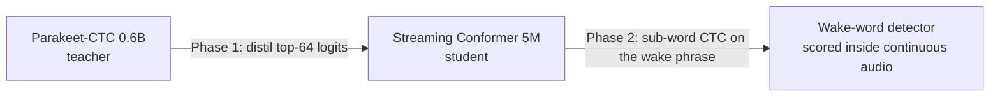

### Ken Nguyen · Nguyễn Khắc Trung Kiên

Mathematics student at the **High School for the Gifted, VNU-HCM** (Ho Chi Minh City, Vietnam).
I work where a clean mathematical model meets messy real data: speech models for Vietnamese,
optimisation under uncertainty, and software that other students use every day.

---

#### Research code

**[wakeword-asr-distillation](https://github.com/KenPTNK/wakeword-asr-distillation)**: wake-word detection for a low-resource language 
A 0.6B-parameter Vietnamese speech recognizer is distilled into a 5M-parameter streaming Conformer,
then fine-tuned on the wake phrase *"năng khiếu ơi"* and scored inside continuous audio against
DS-CNN, BC-ResNet-8 and openWakeWord baselines.

**[viespeaker-short-noisy-sv](https://github.com/MortyPham/viespeaker-short-noisy-sv)**: speaker verification on short, noisy Vietnamese speech 
ECAPA-TDNN adapted to Vietnamese speakers with teacher–student alignment and Gaussian KL, evaluated
under 27 conditions of enrollment length, probe length and noise.

**[vm2c-f1-tyre-strategy](https://github.com/KenPTNK/vm2c-f1-tyre-strategy)**: pit-stop and tyre strategy in Formula 1 
Closed-form stint lengths, an exact dynamic programme over strategies, a fuel model, and a Monte Carlo
risk analysis (VaR, CVaR), calibrated on real lap data with FastF1. Every number in the papers is
re-computed and checked by tests.

#### Software

| Project | What it is | Stack |
|---|---|---|
| [**VN Exams**](https://vn-exams.com) | Practice platform for Vietnam's university entrance exams (V-ACT, HSA, TSA): question bank, timed full tests, explanations. Source is private. | Next.js, TypeScript, Supabase (Postgres, row-level security) |
| [robot-arm-vision](https://github.com/KenPTNK/robot-arm-vision) | 3-DOF arm that picks up objects located by a camera and a YOLO model | Python, OpenCV, YOLO, Arduino |
| [part-scan](https://github.com/KenPTNK/part-scan) | Classifies bearings, bolts, gears and nuts with a CNN and YOLOv8 · [live](https://part-scan-kenptnk.streamlit.app/) | Streamlit, TFLite, YOLOv8 |
| [smart-home-iot](https://github.com/KenPTNK/smart-home-iot) | Desktop app that monitors and switches home devices through Firebase | C#, WinForms, Firebase |

Earlier web coursework (MindX, 2024–2025): [euler-library](https://github.com/KenPTNK/euler-library) ·
[premier-league](https://github.com/KenPTNK/premier-league) · [ant-shop](https://github.com/KenPTNK/ant-shop)

#### Contact

khactrungkiennguyen@gmail.com
